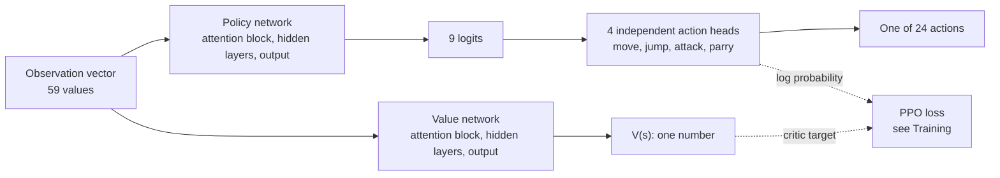
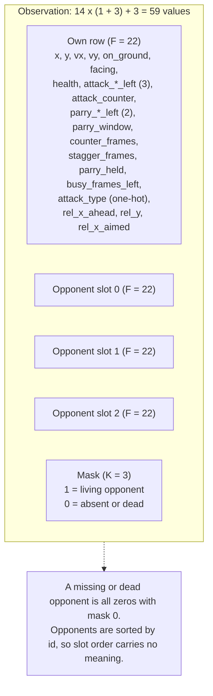
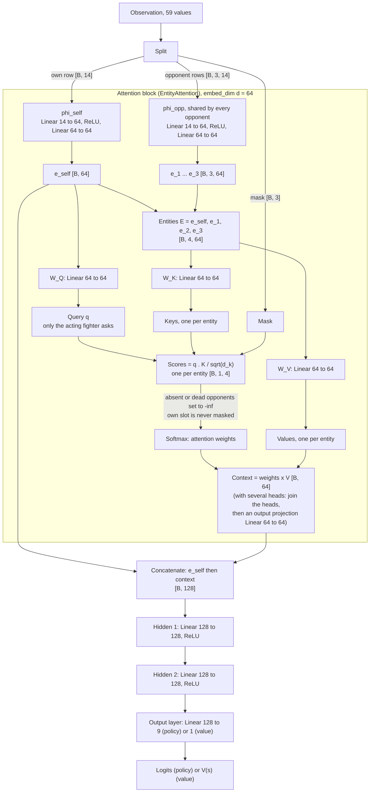
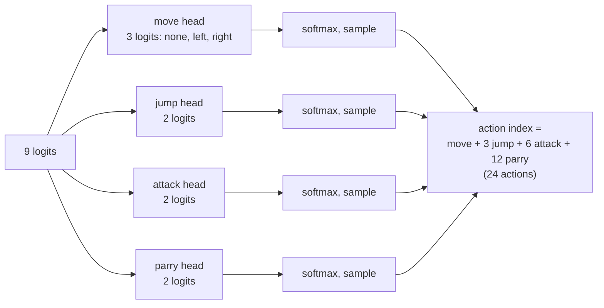
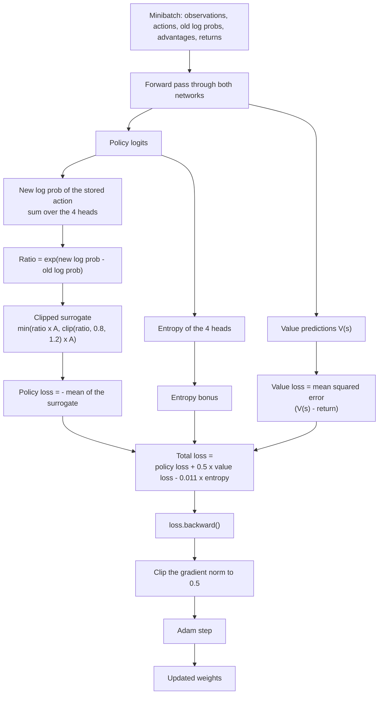

# The neural network

This doc shows how the agent decides, and how that decision is trained. Read the diagrams
top to bottom to follow a decision, then bottom to top to follow the gradients. For the
training loop around it see [training-process.md](training-process.md). For the layout of
the input see [simulation-spec.md](simulation-spec.md#observation).

Code: [`agents/policy.py`](../src/arena_ai/agents/policy.py) (`ActorCritic`,
`AttentionNetwork`), [`agents/attention.py`](../src/arena_ai/agents/attention.py)
(`EntityAttention`), [`agents/distribution.py`](../src/arena_ai/agents/distribution.py)
(the action heads) and [`training/ppo.py`](../src/arena_ai/training/ppo.py) (the loss).
Sizes are the defaults in [`configs/agent.yaml`](../configs/agent.yaml): `embed_dim` 64,
`num_heads` 4, `hidden_layers` [128, 128], and `observation.max_opponents` 3.

## Two networks, one input

`ActorCritic` holds two separate networks with **no shared parameters**. Both read the same
observation. The **policy network** (the actor) outputs 9 logits that become the action.
The **value network** (the critic) outputs one number, the expected return, which PPO uses
to judge how good an action was. Each has its own attention block.

## What the agent sees

The input is one flat vector from the acting fighter's point of view (details and scaling in
the [simulation spec](simulation-spec.md#observation)). `F` is 22 features per fighter and
`K` is the number of opponent slots (3).

## Inside one network

The same structure is used twice, once for the policy and once for the value. Only the
output layer differs (9 logits, or 1 value). Every box labelled "Linear" is a weight matrix
plus a bias; every parameter in the diagram is trained.

How to read it:

- **Embeddings.** `phi_self` turns the acting fighter's 22 numbers into a 64-number summary,
  `e_self`. `phi_opp` does the same for each opponent with the **same weights**, so what is
  learned about one opponent applies to all of them.
- **Query, keys, values.** Only the acting fighter has a query. Every entity (itself and each
  opponent) has a key and a value. A score is how well the fighter's query matches an
  entity's key. After the softmax the scores become weights that sum to 1, and the
  **context** is the weighted sum of the values: a blend that leans toward the entities the
  fighter "attends to".
- **Heads.** With `num_heads` above 1 the 64 numbers of the query, keys and values are
  split into slices (4 heads: 16 numbers each). Every head runs its own softmax over all the
  entities, so one head can lean toward the nearest opponent and another toward the one
  whose swing is about to land. The heads' outputs are joined and mixed by an output
  projection. The split does not change the parameter count.
- **Mask.** An absent or dead opponent gets a score of minus infinity, so its weight is
  exactly 0 and it has no influence, whatever its (zeroed) row holds.
- **Concatenate.** The hidden layers receive `[e_self ; context]` side by side, so the
  fighter's own state reaches them directly and is not only one entry in an average.
- **Limits.** The context is a blend, not each opponent separately: two opponents that
  swing at once can have their frame countdowns averaged within a head, which is why there
  are several heads. Each row carries `rel_x_ahead`, `rel_y` and `rel_x_aimed` (position
  relative to the acting fighter), so the network does not have to subtract two absolute
  positions to tell a near threat from a far one.

## The decision

The 9 policy logits are split into four independent categorical distributions
([`FactoredCategorical`](../src/arena_ai/agents/distribution.py)). The action index is built
from one choice per head, and its log probability is the sum of the four heads' log
probabilities.

During training the action is sampled. In the viewer the trained agent plays the most likely
choice of each head ("Best move") or samples ("Varied").

## Training

[`train_step`](../src/arena_ai/training/ppo.py) runs once per minibatch of the rollout. The
rollout supplies, for each step, the observation, the action taken, the log probability it
had when taken (`old log prob`), the **advantage** (how much better than expected, from GAE
and normalized) and the **return** (the discounted reward to go).

### Where the gradients go

`loss.backward()` sends gradients back along every arrow above, in reverse:

| Loss term | Reaches | Through |
| --------- | ------- | ------- |
| Policy loss (via the ratio) and entropy bonus | the **policy network** only | the output layer, the hidden layers, then the attention block: `W_V` and `W_K` (through the context and the scores), `W_Q`, `phi_opp` (through the keys and values of the opponents), and `phi_self` (both directly through `e_self` and through the query, key and value of the acting fighter) |
| Value loss | the **value network** only | the same path in its own copy of the layers |

The two networks share no parameters, so the value loss never changes the policy and the
other way round. The advantage and return are fixed numbers in this step: they come from the
rollout and carry no gradient. A masked opponent has weight 0, so it receives no gradient
either.

### Why each piece is there

- **Clipped ratio.** It stops one update moving the policy far from the one that collected
  the data. `clip_range` is 0.2.
- **Value loss.** It trains the critic to predict the return, so the advantage (return minus
  prediction, smoothed by GAE with `discount_factor` 0.99 and `gae_lambda` 0.95) is a fair
  signal. `value_loss_coef` is 0.5.
- **Entropy bonus.** It keeps the action distributions from collapsing too early, so the
  agent keeps exploring. `entropy_coef` is 0.011. It is subtracted because the optimizer
  minimizes.
- **Gradient clipping.** It limits how large one update can be (norm 0.5).

## Checkpoints

A checkpoint stores the weights, the optimizer state and a `signature` (the observation
`spec_version`, the features per fighter, `hidden_layers`, `embed_dim`, `num_heads` and the
activations). Loading checks it and names each difference. `max_opponents` is not in the
signature, because no weight depends on it: a network trained with 3 opponent slots loads
with 5.

## Size

With the defaults the network has 112,778 parameters: 56,905 in the policy network and 55,873
in the value network.
