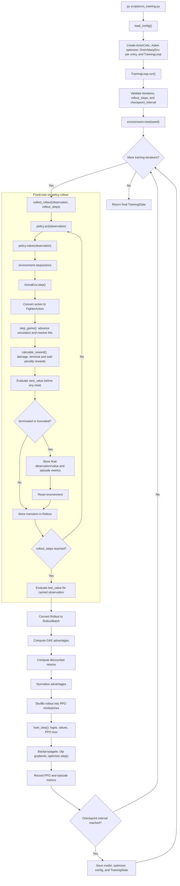

# Training process

Arena AI uses an on-policy PPO workflow. The current implementation trains one
learner in a headless environment against the environment's configured
opponent. The training loop is reusable: it receives an environment factory, a
policy adapter, an update callback, and an optional checkpoint callback.

## Configuration

Training defaults are loaded from [`configs/agent.yaml`](../configs/agent.yaml)
through [`load_config`](../src/arena_ai/config.py). The `training` section
defines:

- `iterations` — number of rollout-and-update cycles.
- `rollout_steps` — environment transitions collected in each cycle.
- `checkpoint_interval` — cycles between checkpoint callbacks.
- `seed` — optional seed for the initial environment reset.
- `opponents` — one entry per parallel environment, in order. Each entry lists the
  opponents the agent faces at once in that environment (1 to `observation.max_opponents`
  names; a bare name means one). The number of entries is the number of environments, so
  `[[approach], [approach, idle], [runner, parrier, idle]]` runs a one-on-one, a 1v2 and a
  1v3, and a single entry uses the scalar environment path. The opponents of an entry are
  allies: they never hurt each other, and the fight ends when the agent or all of them are
  dead.
- `num_envs` — the most environments allowed. Training refuses to start, with an
  error, if `opponents` lists more entries, or an entry has no names or more than
  `observation.max_opponents`.
- `seed` — the one seed for all training randomness (`null` for a different run each time).
  It seeds the network's initial weights and action sampling, and each environment's own
  generator (environment `i` uses `seed + i`). That generator draws spawn positions, the
  scripted opponents' per-episode options and the dice of the `parrier` and `random`
  opponents.
- `env_workers` — worker processes that step the environments at the same time (`1` steps
  them one after another in the training process). See "Parallel environments" below.
- `randomize_spawns` — start each episode with random fighter positions.
- `randomize_opponents` — redraw the scripted opponents' options at every episode reset,
  from the environment's seeded generator, so a learner cannot memorize one fixed distance
  or timing. Only `approach` and `parrier` have options. The next two keys are the ranges.
  Off, they use fixed defaults (offset 0, attack chance 0.2). The `parrier` and `random`
  opponents draw their dice from that generator either way, so training is reproducible.
- `swing_start_offset_m` — `[low, high]` meters added to the distance at which `approach` and
  `parrier` start a swing. Negative walks closer first. Positive swings early, while still
  out of reach: they keep walking during the 16-frame wind-up, so the gap closes.
- `hunter_attack_chance` — `[low, high]` range of the `parrier`'s per-step chance to attack a
  learner that is not walking away from it.
- `max_episode_steps` — episode time limit in simulation steps (1500 is 25
  simulated seconds at 60 Hz). `null` uses the environment default of
  `sim_hz * 10` steps. A fight that reaches the limit is truncated, not won.
- `stats_window` — number of recent episodes used for the rolling episode
  statistics, overall and per opponent.
- `print_stats` — print the training statistics. Set `false` for silent
  training. The statistics are still computed and saved in checkpoints.
- `print_interval` — iterations between printed statistics. The first and
  last iteration of a run always print.

Environment `i` plays `opponents[i]`. The names come from `OPPONENTS` in
[`agents/scripted/registry.py`](../src/arena_ai/agents/scripted/registry.py) (`approach`, `parrier`, `idle`,
`runner`, `random`). `parrier` parries every attack it can see from the front, so the learner
cannot win against it by attacking head on. It earns only parry rewards until it finds
another way past, so give it a share of the environments, not all of them, and keep
some easy opponents (`idle`, `random`) for a winning signal. `runner` flees from the
learner and jumps over it when cornered, so it teaches the learner to chase.

An iteration is not an episode. A rollout collects exactly `rollout_steps`
transitions, resetting the environment whenever an episode terminates or is
truncated. A rollout can therefore contain multiple episodes or end in the
middle of an episode.

## Current loop

[`TrainingLoop.run`](../src/arena_ai/training/train.py) performs this sequence:

1. Reset the environment(s).
2. Collect one fixed-size rollout with the unchanged policy. With more than
   one environment, each environment advances together and contributes
   `rollout_steps` transitions to the PPO batch.
3. Pass the rollout to the update callback.
4. Record training metrics.
5. Save a checkpoint when the configured interval is reached.
6. Repeat for the configured number of iterations.



The rollout boundary is a step budget, not an episode boundary. If an episode
ends during collection, the final observation is valued before reset, then the
environment is reset and collection continues until `rollout_steps` transitions
have been stored. PPO updates use only that fixed batch before the next rollout
is collected.

When training visualization is enabled, the visualizer receives the terminal
frame for one simulation step only. `TrainingLoop` then resets the environment
within the same rollout, so visualization never waits for a training episode's
end screen or restart button. With parallel collection enabled, only the
environment with the highest current episode return is rendered; all
environments still contribute transitions to the shared policy update.

[`TrainingLoop.collect_rollout`](../src/arena_ai/training/train.py) runs policy
inference under `torch.no_grad()`. The acting interface is intentionally
separate from the PPO forward interface:

- `policy.act(observation)` returns a Python `int` action and Python `float`
  log-probability. With a batch of observations it returns lists of each.
- `policy.value(observation)` returns a Python `float` critic estimate (a list
  for a batch).
- `PolicyAdapter` runs both on a CPU copy of the network and refreshes it with
  `sync()` after every PPO update.
- The PPO update callback can use its own callable network interface returning
  `(logits, values)` for [`train_step`](../src/arena_ai/training/ppo.py).

The scalar boundary is checked before data enters
[`Rollout.add`](../src/arena_ai/training/rollout.py), where observations,
actions, rewards, terminal flags, values, and old log-probabilities are stored.
The rollout is converted to a [`RolloutBatch`](../src/arena_ai/training/rollout.py)
after collection and is discarded after the update.

## Parallel environments

**Why it exists.** Stepping the simulation is about half of a rollout, and one core does it
for every environment in turn. **What it does.** With `env_workers` above 1,
[`AsyncVectorEnv`](../src/arena_ai/envs/async_vector_env.py) splits the environments over
worker processes. A worker owns its environments for the whole run, because each holds the
state of a fight, so there is no shared task queue. Each rollout step has three parts:

1. The training process sends every worker its environments' actions.
2. The workers step their environments at the same time.
3. The training process waits for all of them, puts the results back in environment order
   and runs the network on the whole batch.

**What does not change.** The network, the optimizer and the update stay in the training
process. Observations, rewards and flags arrive in the same order and with the same
features as with `VectorEnv`, and a run with the same `seed` gives the same data. A test
checks this step for step, including auto-resets.

**Why processes, and how many.** The simulation is pure Python, so threads would take turns
on the interpreter lock, and a GPU cannot run it. Environments are dealt out round-robin
(environment `i` to worker `i % workers`), so the slow ones spread out. Measured on 16
environments and 12 cores, the time to step all of them was:

| Workers | 1 (no workers) | 4 | 8 | 10 | 16 |
| --- | --- | --- | --- | --- | --- |
| Speedup | 1.0x | 2.1x | 3.0x | 3.0x | 2.0x |

Ten is no faster than eight, because 16 environments over 10 workers leaves some workers
with two and the step waits for them. Sixteen is slower, because it has more processes than
cores and more messages. Use a divisor of the environment count.

**What it buys overall.** Stepping the environments gets about 3x faster, but a whole
training iteration only about 1.2x (20 iterations of 512 steps took 107 s, and 88 s with 8
workers). The rest is the network (three small forward passes per step, one for the actions
and two for values) and the PPO update, which this does not touch.

**Limits.** The training visualizer needs the environments in the training process, so
`VISUALIZE_TRAINING` falls back to `VectorEnv`. Environment factories must be picklable
(module-level functions and `partial`, not lambdas). A failure in a worker is raised in the
training process with the worker's traceback.

## Resuming a run

`scripts/run_training.py` saves `checkpoints/latest.pt` at every checkpoint
interval and on `Ctrl+C`. It also writes `iter_<number>.pt` files into a
per-run folder, `checkpoints/run-<timestamp>/`, so earlier runs are kept when
`latest.pt` is overwritten by a new run.

To continue a run, set `RESUME_FROM` near the top of the script to a checkpoint
path. The script then:

1. Restores the model weights, optimizer state and `TrainingState` (iteration,
   environment steps, episodes and wins).
2. Synchronizes the CPU acting copy of the network with the restored weights.
3. Runs `training.iterations` **more** iterations, numbered after the saved
   ones. A run saved at iteration 600 with `iterations: 600` ends at 1200.

`Ctrl+C` is held until the current PPO update finishes, so a checkpoint saved on
interrupt never holds weights that are partway through an update while its
iteration count excludes it. A second `Ctrl+C` stops at once and may save such a
partial update.

A resumed run is a valid continuation, not an exact replay. These are not saved:
the random number generators (a configured seed is offset by the saved iteration
so the stream does not repeat), the rolling per-opponent statistics windows
(they refill over the next `stats_window` episodes), and the episode that was in
progress, plus the network `signature` (the observation `spec_version`, the feature
count and the network hyperparameters). Loading checks it and raises an error that names
each difference, so an old or differently shaped checkpoint is refused with a clear
message instead of a raw weight-shape error. `max_opponents` is not part of the signature:
a checkpoint trained at one value loads at another, because the network weights do not
depend on it.

## Bootstrapping and episode boundaries

Each transition stores `next_values[t]`, the critic value for the observation
reached after step `t`. This is evaluated before an environment reset, so a
truncated episode retains the value of its final observation rather than the
initial observation of the next episode.

The update callback receives:

- `last_value` — the value of the observation carried into the next rollout.
- `terminated` — natural terminal flags. These prevent value bootstrapping.
- `episode_ends` — natural terminals or time-limit truncations. These stop
  recursive GAE accumulation across episode boundaries.
- `next_values` — per-transition values used when a truncation requires a final
  observation bootstrap.

The callback should pass these values to
[`advantage_estimation`](../src/arena_ai/training/ppo.py) and use the matching
episode-boundary arguments when calculating
[`discounted_returns`](../src/arena_ai/training/ppo.py). This distinction allows
a time-limit truncation to bootstrap from its final observation while still
preventing advantages from leaking into the reset episode.

## Environment and rewards

[`ArenaEnv.step`](../src/arena_ai/envs/arena_env.py) returns the next
observation, reward, `terminated`, `truncated`, and an info mapping. The
environment adds `info["winner"]` at natural episode termination:

- `"agent"` when the learner survives and an opponent is defeated.
- `"opponent"` when the learner is defeated.
- `None` for non-terminal steps and truncations.

The reward is defined in [`docs/simulation-spec.md`](simulation-spec.md). The
loop accumulates rewards for the current episode. When an episode ends, it
records the completed return and increments the episode count. It increments
the win count only when `info["winner"] == "agent"`.

Besides `step_count` and `winner`, the environment reports cheap per-episode
counters in `info`: `damage_dealt`, `damage_taken`, `swings` (attacks the
learner started), `hits` (steps in which it damaged an opponent), `edge_steps`
(steps within `edge_margin` of a wall) and `opponent` (the opponent's name).

## Training statistics

`scripts/run_training.py` prints a block like this every `print_interval`
iterations when `print_stats` is true:

```text
[iter 100] steps=204,800 episodes=312
  results  win 41%  return +0.35  reward/step +0.0021  (last 100 episodes)
  policy   kl 0.0120  clip 14%  explained var 0.72  entropy 2.31 (move 0.99 jump 0.60 attack 0.60)
  loss     total 0.2295  policy -0.0020  value 0.5175
  actions  attack 31%  jump 12%  left 20%  right 25%  idle 22%
  combat   accuracy 38%  dealt 71  taken 45  near wall 8%  win length 612  loss length 480
  time     0.81s/iter  rollout 0.52s (env 0.10s  act 0.28s  value 0.09s  other 0.05s)  update 0.28s  2,530 steps/s
  vs approach  win 33%  timeout 0%  length 571  (6 episodes)
```

**Why these numbers:** the return of a single episode is noisy, so the results
line uses a rolling window. The policy and critic lines say whether learning is
healthy, and the actions and combat lines say what the agent is actually doing.

| Line | Measure | How to read it |
| --- | --- | --- |
| results | `win`, `return` | Rolling over the last `stats_window` episodes, so recent progress shows. `reward/step` is the mean reward of the rollout and does not depend on how many episodes finished. |
| policy | `kl` | Approximate KL divergence (how far the update moved the policy), averaged over minibatches. Very large means unstable. Near 0 means a learning rate that is too low or a converged policy. |
| policy | `clip` | Share of samples whose probability ratio hit the clip range. About 10% to 20% is typical. 0% means updates barely move the policy, and persistently high means they are too aggressive. |
| policy | `explained var` | `1 - Var(returns - values) / Var(returns)`. Near 1 is a good critic, near 0 predicts nothing, below 0 is worse than a constant. Its scale does not depend on the reward, unlike the value loss. |
| policy | `entropy` | The sum of the three heads, then each head alone, so one head collapsing early (for example never jumping) is visible. |
| loss | `total`, `policy`, `value` | Averaged over every minibatch of the update, not only the last one. |
| actions | `attack`, `jump`, `left`, `right`, `idle` | Share of rollout steps. `idle` is the no-op action. |
| combat | `accuracy` | Hits per swing started. Many swings with a low accuracy means the agent is spamming. |
| combat | `dealt`, `taken` | Mean damage per episode, which is clearer than the reward because the reward also includes the wall penalty. |
| combat | `near wall` | Share of steps within `edge_margin` of a wall, which shows whether it still hugs walls. |
| combat | `win length`, `loss length` | Mean episode length in steps for wins and for losses. Shorter wins mean a more decisive agent. |
| time | `s/iter`, `rollout`, `update`, `steps/s` | Wall-clock time. The rollout splits into time in the environment (`env`), choosing actions (`act`), estimating values (`value`) and `other` (building the batch and recording episodes). Compare it with `update` to see whether the simulation, the network or the PPO update is the bottleneck. |

**Cost:** these are designed to cost almost nothing next to a simulation step.
Measured on this machine, per iteration of 2,048 steps:

- Episode statistics keep running sums over the window, so recording an episode
  takes about 6 microseconds and a summary about 3, however large the window.
- The behaviour statistics and explained variance are a few vectorized
  operations on the batch the update already holds, about 0.3 ms.
- The timing uses four `perf_counter` calls per step, about 0.6 microseconds,
  about 1 ms per iteration.
- The PPO statistics reuse values the loss already computed and are read from
  the GPU once per update, not once per minibatch. Reading a GPU value forces a
  sync, so this is also faster than the earlier per-minibatch reads.
- Formatting a printed block takes about 16 microseconds, so printing is cheap
  too. Turning `print_stats` off only silences the output.

The metrics after each update are in `TrainingState.metrics` (the values above,
plus cumulative `episodes` and `wins`), the rolling overall figures are in
`TrainingState.episode_stats`, and the per-opponent ones in
`TrainingState.opponent_stats`.

### Per-opponent statistics

`OneVManyEnv` adds `info["opponent"]`, the matchup label: the opponents' names sorted and
joined with `+` (`approach+idle+runner`, or just `idle` for one), and
`info["opponent_count"]`. `OneVOneEnv` is the one-opponent case. The
loop records every finished episode in
[`EpisodeStats`](../src/arena_ai/training/stats.py), which keeps one rolling
window overall and one per opponent. Per opponent it reports `win_rate`,
`truncation_rate`, `mean_length` and the episode count, plus every figure in the
tables above. A high truncation rate against an opponent, such as `idle`, means
the time limit is ending episodes before the fight is decided, so raise
`max_episode_steps`.

## PPO update boundary

PPO is on-policy. The batch collected before an update belongs to the old
policy and must not be reused indefinitely after the policy changes. The
intended update callback computes advantages and returns, runs the configured
PPO epochs/minibatches, and returns scalar metrics. The next iteration then
creates a fresh [`Rollout`](../src/arena_ai/training/rollout.py).

The current repository exposes the reusable loop and PPO building blocks;
[`scripts/run_training.py`](../scripts/run_training.py) now wires those components into a
single runnable workflow. It creates the actor-critic model and optimizer,
constructs the one-versus-one environment, computes PPO advantages and
returns, performs minibatch updates, and saves `checkpoints/latest.pt` at the
configured interval. Run it from the repository root with:

```powershell
py scripts/run_training.py
```

The script uses the values in `configs/agent.yaml`; reduce `training.iterations`,
`training.rollout_steps`, or `training.opponents` there for a short smoke run.

## Network

The policy and value networks (an attention block over the opponents, then hidden layers)
and the loss that trains them are described, with diagrams, in
[network.md](network.md).
